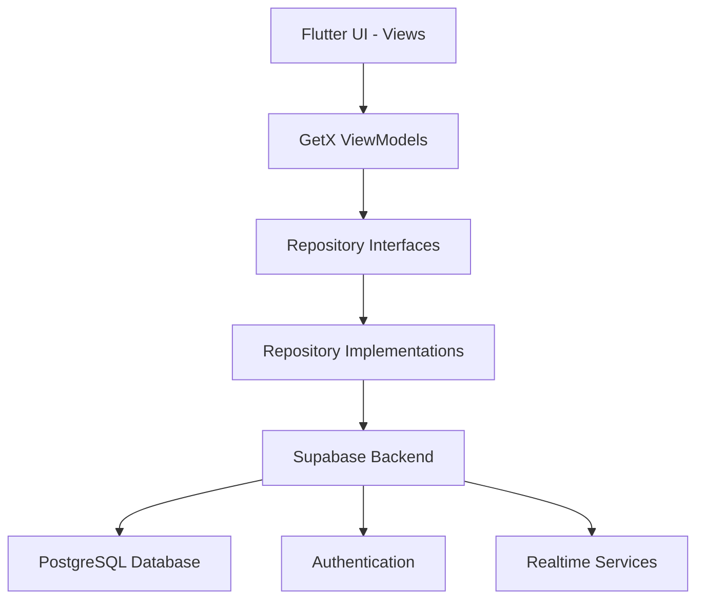

<div align="center">


# DigiKhata

### Smart Digital Bookkeeping & Inventory Management

A modern mobile application designed to simplify financial management, customer credit tracking, and everyday business operations for small retailers.


[Overview](#project-overview) •
[Features](#key-features) •
[Architecture](#application-architecture) •
[Installation](#getting-started) •
[Developer](#developer)

</div>

---

## Project Overview

DigiKhata is a cross-platform digital bookkeeping and inventory management application built using Flutter, GetX, and Supabase.

The application addresses the challenges faced by small retailers who rely on traditional paper-based ledgers to manage customer credit, payments, supplier accounts, and inventory.

By centralizing financial and operational records within a single mobile platform, DigiKhata helps businesses maintain organized accounts, monitor outstanding balances, and make informed business decisions.

## Key Features

| Module | Description |
| :--- | :--- |
| Smart Dashboard | Centralized overview of outstanding balances, financial activity, customers, and business performance. |
| Customer Management | Manage customer profiles, contact information, and account records. |
| Digital Khata | Record credit and payment transactions and monitor customer balances. |
| Inventory Management | Manage products, categories, stock quantities, pricing, and stock movements. |
| Supplier Management | Maintain supplier profiles, purchase records, payments, and outstanding payables. |
| Financial Reporting | Generate financial summaries and analyze business transactions. |
| Real-Time Synchronization | Synchronize supported business records through Supabase Realtime. |
| Financial Audit Trail | Maintain historical records of financial transaction changes. |
| Authentication | User authentication and session management through Supabase Auth. |
| Bilingual Interface | English and Urdu localization for improved accessibility. |
| Modern UI | Consistent Material 3 design with an emerald-inspired visual identity. |

## Technology Stack

| Technology | Purpose |
| :--- | :--- |
| Flutter | Cross-platform mobile application development |
| Dart | Application programming language |
| GetX | State management, dependency injection, and navigation |
| MVVM | Separation of presentation and business logic |
| Supabase | Backend services and authentication |
| PostgreSQL | Relational database management |
| Supabase Realtime | Database change synchronization |
| Row-Level Security | Shop-level data isolation |
| Material 3 | Application design system |
| Git & GitHub | Version control and source code management |

## Application Architecture

DigiKhata follows a feature-based MVVM architecture with a repository abstraction layer to promote maintainability, scalability, and separation of concerns.



### Architecture Principles

- Separation of UI and business logic
- Reactive state management
- Repository-based data access
- Dependency injection through GetX bindings
- Feature-oriented project organization
- Reusable UI components
- Centralized navigation and application theming

### Project Structure

```text
digikhata/
├── android/
├── ios/
├── assets/
│   └── branding/
├── docs/
├── lib/
│   ├── app/
│   ├── core/
│   ├── data/
│   ├── features/
│   └── main.dart
├── supabase/
│   └── migrations/
├── test/
├── pubspec.yaml
└── README.md
```

For additional technical documentation, see:

- [Application Architecture](docs/ARCHITECTURE.md)
- [Release Checklist](docs/RELEASE_CHECKLIST.md)

## Database Architecture

The backend uses PostgreSQL through Supabase to manage relational business data.

| Database Table | Responsibility |
| :--- | :--- |
| customers | Customer profiles and account ownership |
| khata_transactions | Customer credit and payment records |
| products | Product information, pricing, and inventory |
| stock_movements | Historical stock adjustments |
| suppliers | Supplier profiles and account information |
| supplier_transactions | Supplier purchases and payments |
| ledger_audit | Historical financial transaction changes |

### Backend Highlights

- Relational database design with foreign key constraints
- Shop-level access policies using Row-Level Security
- PostgreSQL functions for financial aggregation
- Atomic inventory adjustments through database RPC functions
- Database triggers for financial audit records
- Indexed queries for frequently accessed business records
- Version-controlled SQL migrations

## Security Implementation

DigiKhata incorporates multiple backend security mechanisms:

- Supabase authentication and session management
- Row-Level Security policies for shop-specific data access
- Ownership validation using authenticated user identities
- Database-level constraints for transaction integrity
- Controlled inventory adjustments
- Financial transaction audit logging

## UI & User Experience

The application is designed around a consistent, business-oriented mobile experience.

- Emerald-inspired Material 3 theme
- Reusable interface components
- Clear financial information hierarchy
- Loading, error, and empty states
- Smooth presentation animations
- English and Urdu localization

## Getting Started

### Prerequisites

- Flutter SDK
- Dart SDK
- Android Studio or Visual Studio Code
- Android emulator or physical device
- Supabase account and configured project

### Installation

Clone the repository:

```bash
git clone https://github.com/sscibrahimtahir190422-sketch/DigiKhata-Mobile-Application.git
```

Navigate to the project directory:

```bash
cd DigiKhata-Mobile-Application
```

Install dependencies:

```bash
flutter pub get
```

### Backend Configuration

1. Create a Supabase project for your development environment.
2. Review the SQL migrations in `supabase/migrations/`.
3. Apply the migrations to your development database in the correct order.
4. Configure the application with your Supabase project URL and publishable or anon key.
5. Never include service-role keys or database credentials in the mobile application.

### Run the Application

```bash
flutter run
```

### Code Quality & Testing

```bash
flutter analyze
flutter test
```

## Engineering Highlights

This project demonstrates practical experience in:

- Cross-platform mobile application development
- MVVM architecture and repository patterns
- Reactive state management
- Backend and database integration
- Authentication and authorization
- Relational database modeling
- Real-time data synchronization
- Financial transaction management
- Application localization
- Git-based development workflows

## Developer

**Muhammad Ibrahim Tahir**

Flutter Developer | Mobile Application Development

Passionate about building maintainable, user-focused mobile applications with modern architectures and integrated backend services.

[](https://muhammad-ibrahim-tahir-portfolio.vercel.app/)

[](https://github.com/sscibrahimtahir190422-sketch)

---

<div align="center">

**DigiKhata — Simplifying Business, Digitizing Bookkeeping.**

Developed by Muhammad Ibrahim Tahir

</div>
